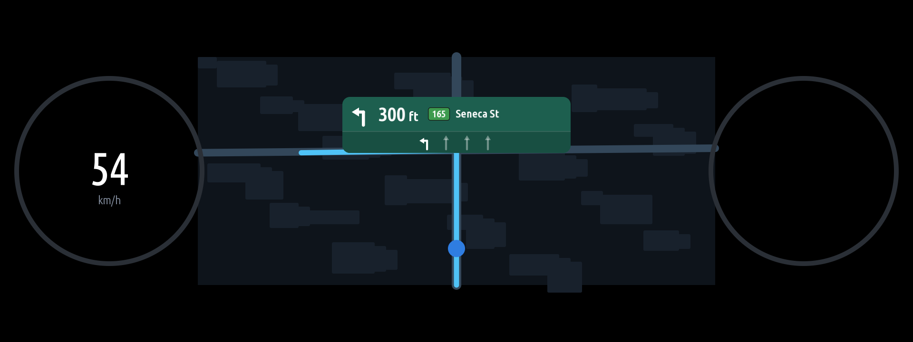

# mgu-apps

Apps for the BMW iDrive 7 head unit (MGU), built on the app kit from
[idrive7-apps](https://github.com/cauliflowermossgrape/idrive7-apps). The repository is an MGU Store
source: `mgu-repo.json` lists every app under `apps/`.

| App | What it does | Needs |
|---|---|---|
| [**Cluster Nav Card**](apps/cluster_nav_card/README.md) (`cluster_nav_card`) | A turn card over the phone's map in the instrument cluster: the next turn's arrow, the distance, the road with its number on a country-style plate, and the lanes. | [Waze on cluster](https://github.com/robertnisipeanu/idrive-apps) |

## Cluster Nav Card



It draws over the CarPlay / Android Auto map that
[Waze on cluster](https://github.com/robertnisipeanu/idrive-apps) shows in the cluster. Despite its name,
Waze on cluster shows any phone map there; it is needed for the map under the card, while the Waze app
itself isn't supported (below).

| Phone app | Where the turns come from |
|---|---|
| **Apple Maps, Google Maps** (CarPlay) | The head unit's own navigation, which the phone hands its guidance to: the manoeuvre, the distance, the road and Google's lane hint. Shown on a green card. |
| **Waze** (CarPlay) | **Not supported.** Waze sends the car no guidance, so there's no card while it guides. Reading its turns off the screen is work in progress on the `waze-support` branch. |
| Any | A demo drive, or a guidance file another program writes. |

The details are in [apps/cluster_nav_card/README.md](apps/cluster_nav_card/README.md): the guidance sources and what the car
was seen to send, the settings, the road number plates, the traffic side and the event log.

## What the head unit needs

- The custom-apps setup from [idrive7-apps](https://github.com/cauliflowermossgrape/idrive7-apps): root
  access, and MainApp's provisioning hook (`deploy/mgu-app-install.sh patch --persist`), without which
  MainApp hides apps BMW didn't provision.
- What each app lists under **Needs** above. For Cluster Nav Card that's Waze on cluster and its cluster render
  service from the MGU Store, which put the phone's map in the cluster and take Cluster Nav Card's layer.

## Build

BMW's app SDK isn't in the repository. Extract it from your own head unit
(`node kit/tools/extract_sdk.js`, see the comments in it) into `oap-sdk/`, then, for any app in `apps/`:

```sh
python3 kit/tools/build.py <app>         # -> dist/<app>@<version>.mgu and .tgz, e.g. cluster_nav_card
node kit/tools/emu.js <app>              # the app's page in a browser (the cluster isn't emulated)
node kit/tools/test_cluster_nav_card.js  # Cluster Nav Card's tests (no SDK needed)
```

Node.js and Python 3 are needed. The apps run on the unit's Node.js 8.

## Install

**From the MGU Store.** Add this repository. The Store builds each app on the unit.

**By SSH.** Copy `deploy/mgu-app-install.sh` and `dist/<app>@<version>.mgu` to one folder on the unit, then:

```sh
sh mgu-app-install.sh install <app>@<version>.mgu
```

## Licence and credits

MIT ([LICENSE](LICENSE)). The app kit (`kit/`, `deploy/mgu-app-install.sh`, `deploy/mainapp-patch.js`) comes
from [idrive7-apps](https://github.com/cauliflowermossgrape/idrive7-apps), MIT. Third-party parts and what is
deliberately left out are listed in [NOTICE](NOTICE).
