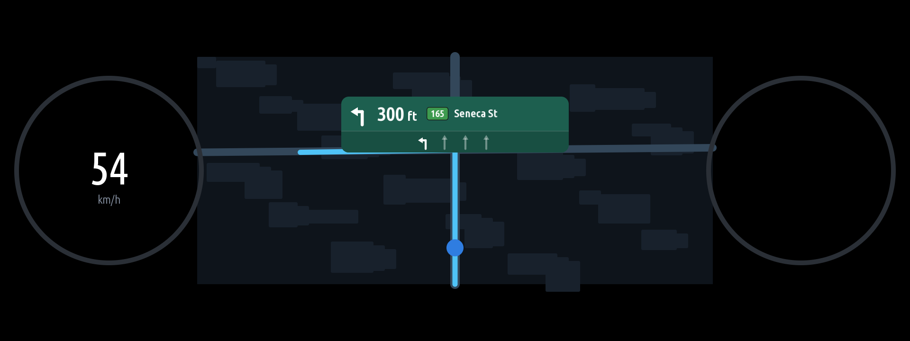
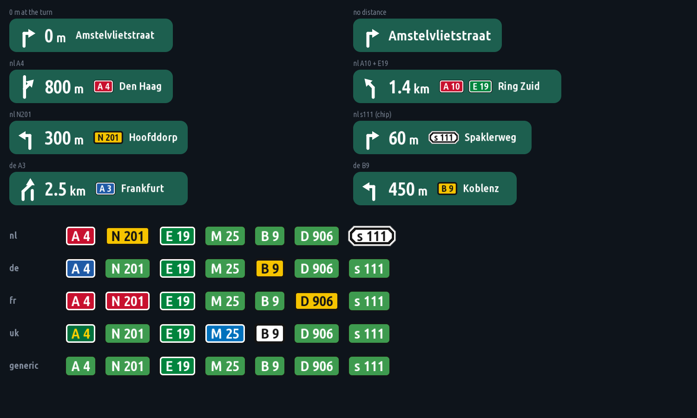

# Cluster Nav Card

A turn card over the phone's map in the instrument cluster, in the style of a navigation app's:
the next turn's arrow, the distance to it, the road (its number in a green chip, then its name)
and the lanes, with the lanes to take lit.

**Supported:** Apple Maps and Google Maps over CarPlay, BMW's own navigation (as an option), a guidance
file, the demo drive. **Waze isn't supported:** it sends the car no guidance at all (below), so while
Waze guides there is no card. Reading its turns off the centre screen is work in progress on the
`waze-support` branch.

It was called Nav Card (`nav_card`) up to 0.8.8. The new id is another app to the head unit: remove
`nav_card`, then install Cluster Nav Card. Its settings start from the defaults.



| File | What it does |
|---|---|
| `card.js` | Draws the card. It scales to any size and draws the same on the GPU recorder and the software canvas. Manoeuvres: straight, left / right, slight, sharp, U-turn, merge, exit, roundabout (exit 1–4), arrive. |
| `source.js` | Where the guidance comes from: the car's navigation, the guidance file, or a demo drive (below). |
| `shields.js` | Road numbers on plates styled the way each country signs them (A4 red in the Netherlands, blue in Germany; E-roads green), for any number; "A-4", "e-19" are read as A4, E19; an exit's number gets the blue exit plate. |
| `headunit.js` | Reads the head unit navigation's turn-by-turn guidance, CarPlay's included, over SOME/IP. |
| `overlay.js` | The card's layer in the cluster, over the map that Waze on cluster shows. |
| `main.js` | The app's page: the card as it is now, larger, and what each part found. |
| `cluster_render_client.js` | The cluster render service's Node client. |

## What it needs on the head unit

From [eroobeeroo/idrive-apps](https://github.com/eroobeeroo/idrive-apps), installed through the
MGU Store:

- **Waze on cluster.** Despite its name, it puts whichever CarPlay or Android Auto map is up (Google
  Maps, Apple Maps, Waze) in the cluster, and writes `/run/waze-on-cluster/status.json`. The card
  needs it for the map under it, whatever the phone app; the card's turns still need an app that sends
  guidance (not Waze).
- **The cluster render service** (`/dev/shm/cluster-render/render.sock`), which takes the card's
  image layer.

The card shows only while the map is in the cluster (target `panel` or `map`) and there is a
route. It never holds the cluster on its own. Without these two the card never shows; the app's
page and the `overlay: ...` log lines say what is missing.

## Where the guidance comes from

**From the car (default).** When CarPlay or Android Auto guides (Apple Maps, Google Maps; not Waze, see below),
the phone sends its turn-by-turn data to the head unit
(`navigation.projectedmodeguiding.ProjectedModeGuiding`). The navigation then publishes it the same way
as for its own route, for the cluster's turn arrow, in `de.bmw.infotainment.navigation.guiding.Guidance`
(service 64282, `Main_Instance`). Cluster Nav Card subscribes to these fields there:

| Field | What the card takes from it |
|---|---|
| `guidanceState` | a route is being guided (`ACTIVE`) |
| `guidingProvider` | who guides: `CAR_PLAY`, `ANDROID_AUTO`, ... or `NONE` (BMW's own navigation) |
| `conclusiveDart` | the next manoeuvre: an intersection's turn, a branch (fork, highway exit or merge), a roundabout (exit angle and number), the destination; its distance; the road's name and number |
| `currentLaneGuiding` | the lanes: the arrows on each, and the lanes to take lit |
| `nextIntersection` | the road and the distance when the manoeuvre has none |

From `a4a.carplay.CarPlayManager` it also reads `projectedGuidanceMetadataAvailable`, to say on the
page when the phone sends no turn data.

All of this comes from the unit's interface catalog and has **not been seen on a car yet**. How
the native module hands over unions and enums is taken from the Service app: unions come as
`{ member: value }`, enums as numbers or names, and both are read. The roundabout's `exitAngle` is read
as the change of heading from the way in to the way out, clockwise: 90 right, 270 left, 180 back. Going
straight on through Dutch roundabouts it came as 300–325 (on, bending a little left); read as the angle
driven round the ring, as before 0.9.1, that drew a sharp turn back. The traffic side only sets which way
round the ring is drawn. Without an angle, the exit number is used. On a drive, the first three
values of each field go to the app's log (`headunit conclusiveDart #1: ...`), and the latest ones to
`/dev/shm/nav-card/headunit-raw.json`. Those are what to send back if a manoeuvre or the lanes come
out wrong.

**When the phone sends no turns to `Guidance`** (Google Maps did not: `projectedGuidanceMetadataAvailable`
false, `guidanceState` INACTIVE), but CarPlay guides (`projectedGuidanceActive`), Cluster Nav Card asks the
navigation's event list once a second: `GuidanceEventList.queryContent`, from the car to the destination,
for manoeuvres, destinations and lane guidings. As the car gives Google Maps' guidance, the list holds two manoeuvres: the one the phone's
banner shows, with its distance as text (`"60" METER`, counting down), and the one after it, with no
distance (`" " NONE`). The card is the first one with a distance. Just past a turn, the phone lists
"straight on, 0 m" first: the card then shows the turn after it, without a number. `rawDistance` is not
always metres (it was 1 next to "60" METER), so the text is used. The car's own distances
(`currentDistances`) were 0. The list had no lane guidings for the phone, but Google Maps' lane hint
comes as `currentLaneGuiding` (in `Guidance` and in `ProjectedModeGuiding`, an empty `rows` when there
is none): the card's lane strip, the lanes the phone lights lit. If the list has no manoeuvre either, the card
shows the destination: the flag, the distance left and the arrival time, from
`ProjectedModeGuiding.waypoints` or `Guidance.finalDestinationInfo`. Which form the native module
wants enums in on the way in is not known, so both names and numbers are tried, and the one that works is
logged.

Of the manoeuvres listed, the card shows the first real turn, the way the phone app's own banner does.
A "straight on" (keep going) shows only when nothing else is listed. While the card comes from the
event list, the app's page lists each event next to the card: its kind, direction, distances and road.

**The event log.** With the car's guidance, the app writes what the navigation sends to
`data/cluster_nav_card-events.jsonl` in its folder on the unit. The app's page shows the full path. There is
one JSON line a record: `query` holds a queryContent answer whole, with the card it gave and how the
distance was found (`distSrc`); `field` holds a notified field's value; `card` holds the card whenever it
changes; `error` holds a failed query. Past 4 MB the file moves to `cluster_nav_card-events.1.jsonl`.
**Settings > Event log > Off** stops it. Copy it off the unit after a drive:
`scp root@<unit-ip>:<path shown on the page> .`

**Waze isn't supported: it sends the car nothing.** In the event log of 2026-11-08, Waze over CarPlay set
`projectedGuidanceActive` and nothing else: `guidingProvider` stayed `NONE`, the event list stayed empty,
and no waypoints came. The car's own head-up display showed no guidance from it either. So there is nothing
for the card to show: it stays hidden, and the page says the phone sends the car nothing (Waze isn't
supported). The last route is dropped when the phone stops guiding or another app
takes over, so the old app's arrival time doesn't show under the next one. The destination-only card also needs a
phone app as the provider (`CAR_PLAY`, ...): with `NONE` the car still answers the last app's waypoints.
A second log on 2026-11-08 found the same: from Waze, only `projectedGuidanceActive`. Reading Waze's
turns off the screen instead is on the `waze-support` branch, not in this version.

**BMW's own turn box.** Near a turn, the cluster draws its own turn box from the same guidance, over
the map and over the card. An app's layer can't go above it. Set **Card height > Lower** to keep the
card under it, or switch the box off in the car's own display settings, if your car has that option.

By default only the phone's guidance is shown. **Guidance from > Also the BMW navigation's route**
also shows the built-in navigation's route.

The card also reads:

- **The guidance file** `/dev/shm/nav-card/guidance.json`, written by any other program that has
  the guidance. Write it a few times a second, and replace it whole each time (write a temporary
  file, then rename it over the old one):

```json
{ "v": 1, "t": 1793560000000, "app": "My guidance reader",
  "maneuver": "left", "distance_m": 91, "road": "Seneca St", "shield": "165",
  "lanes": [{ "dirs": ["left"], "on": ["left"] }, { "dirs": ["straight"] }, { "dirs": ["straight"] }] }
```

`t` is `Date.now()` at writing; a file older than 4 s means no route. `maneuver` is one of
`straight`, `left`, `right`, `slightLeft`, `slightRight`, `sharpLeft`, `sharpRight`, `uturnLeft`,
`uturnRight`, `mergeLeft`, `mergeRight`, `exitLeft`, `exitRight`, `roundabout` (with `exit` 1–4)
and `arrive`. `lanes` go left to right: `dirs` are the arrows painted on a lane, `on` the ones
of them that take the route. The car's guidance comes first; the file is used while the car has none.

- **Demo route** (Settings): a short drive through a few manoeuvres, the distance counting down.
  It replaces the other two.

## Road numbers

The numbers at the start of a road's text ("A4 Den Haag", "A10 / E19 Ring Zuid", "A4 E19 Leiden",
"a-4 e-19", "s111 Spaklerweg"), or
the description's icon texts, go on plates in front of the name. Each one is styled by its letters and the
**Road number plates** setting. The plates are drawn, not pictures, so they work for any number: the
kit's canvas draws no SVG, and the sign files on Wikimedia Commons would mean a picture for every number.
In the Netherlands, the cities' s-routes (s111) get their own plate: a white elongated octagon with a thick
black ring. A number no style covers gets the card's green chip.

An exit's number at the start of the name, after any road numbers ("3 Leiden", "A4 E19 3 Leiden", "8a
Schiphol"), goes on the exit's plate, as on the Dutch motorway signs: blue, a white ring, the exit
pictogram and the number. A Dutch ordinal stays part of the name ("1e Jan Steenstraat", "2de ...").



## Traffic side

The way round a roundabout follows the traffic side. The side is taken from the first of these that
gives one:

1. **Settings > Traffic side**, when set to right- or left-hand.
2. The navigation's own `driveDirection` for that roundabout. Google Maps sends it: `RIGHT` in the
   Netherlands.
3. The car's position: the `trafficSide` event of `navigation.externalize.adasng.CCP`, from the map.
4. The car's country (`CCP.countryCode`), using a table of the countries that drive on the left:
   the UK, Ireland, Malta, Cyprus, Japan, Australia and others.
5. Otherwise right-hand.

The app's page shows the side and where it came from.

## Settings

| Setting | Choices |
|---|---|
| **Card in the cluster** | over the map while there is a route (default), or Off (nothing is sent to the cluster) |
| **Card position** | top centre of the map (default), top left or top right |
| **Card height** | under the cluster's model badge (default), at the very top of the map, or lower: under BMW's own turn box |
| **Card size** | small, normal or large |
| **Card width** | standard (default: 480 px at the normal size, a long name cut short with an ellipsis), or fit the text |
| **Road number plates** | Netherlands (default), Germany, France, United Kingdom, or plain chips |
| **Distances** | metres and kilometres, or feet and miles |
| **Guidance from** | the phone (CarPlay, Android Auto; default), or also the BMW navigation's route |
| **Traffic side** | automatic (default), right-hand, or left-hand |
| **Demo route** | Off, or On |
| **Event log** | On (default), or Off |

## Build and test

```sh
python3 kit/tools/build.py cluster_nav_card
node kit/tools/test_cluster_nav_card.js
node kit/tools/emu.js cluster_nav_card          # the app's page; the cluster itself is not emulated
```

## Credits

- The approach, a layer over the Waze map that follows its `status.json`, comes from
  [Cluster Info](https://github.com/eroobeeroo/idrive7-cluster-info) by eroobeeroo. Its code is
  GPL-3.0 and is not used here: this app's code is its own.
- `cluster_render_client.js` is the render service's Node client from
  [robertnisipeanu/idrive-apps](https://github.com/robertnisipeanu/idrive-apps)
  (`native/cluster-render`), Copyright (C) 2026 Robert Nisipeanu, MPL-2.0. It is unchanged, as
  its header says.
